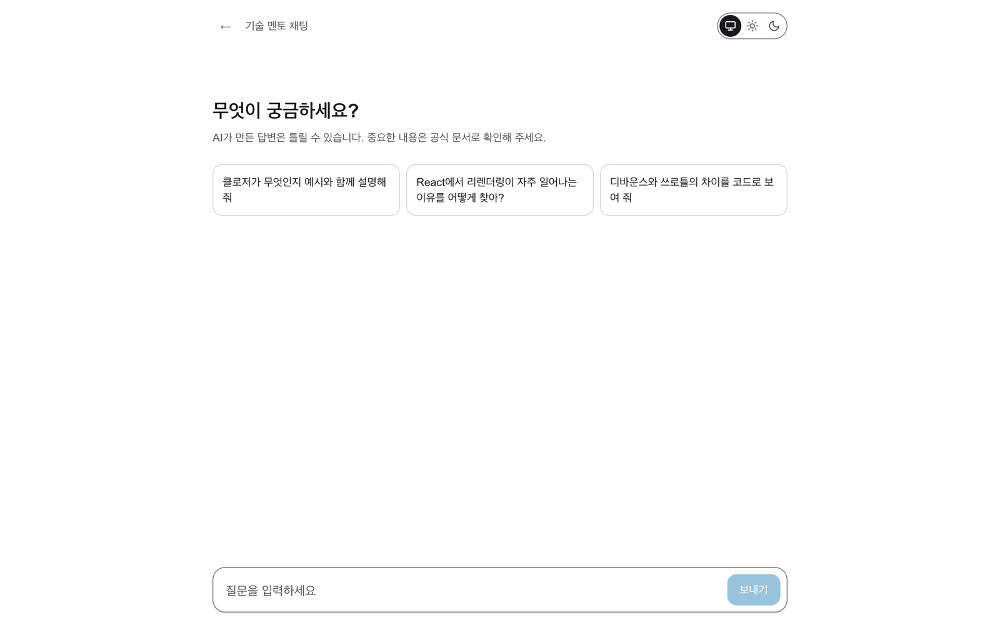
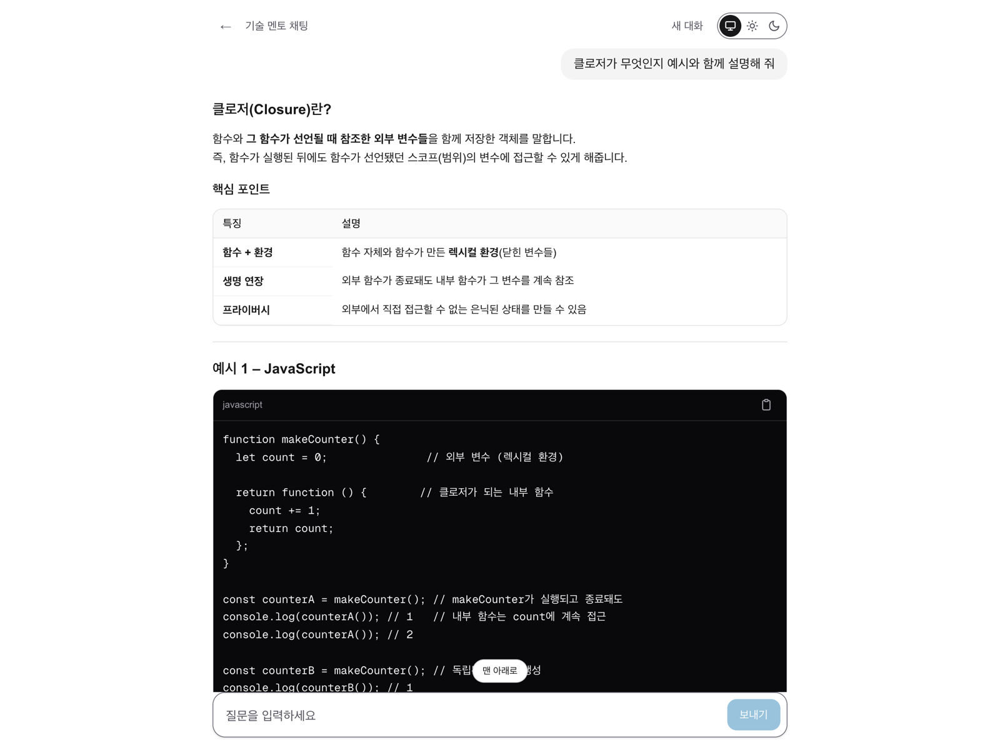
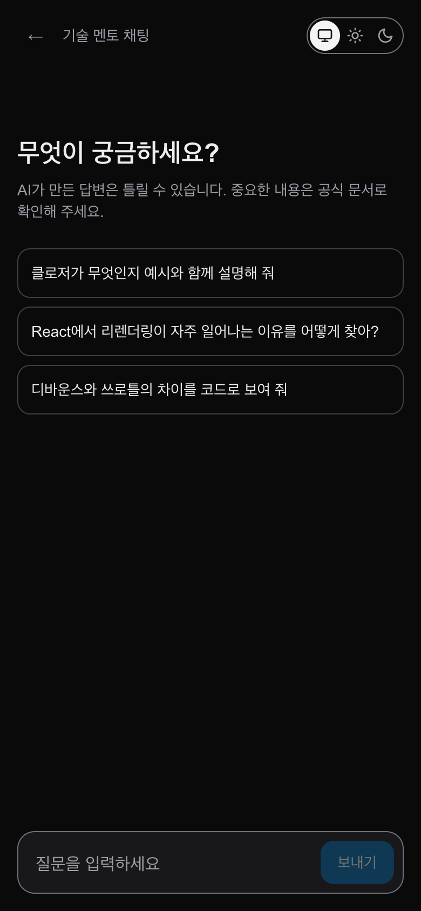

```json
{
  "schemaVersion": 1,
  "slug": "portfolio-chat",
  "title": "개발자를 위한 AI 기술 멘토 채팅",
  "description": "포트폴리오의 내부 AI 채팅을 독립된 서비스로 분리해, 스트리밍 응답과 마크다운·코드 블록 렌더링, 입력 검증과 요청 제한을 갖춘 Next.js 채팅으로 새로 구현했습니다.",
  "image": "https://raw.githubusercontent.com/side-projects-labs/portfolio-chat/92c742f58bc6e08705c0750e44ad853afa65116c/PROJECT.png",
  "stacks": [
    "Next.js",
    "React",
    "TypeScript",
    "Tailwind CSS",
    "Vercel AI SDK",
    "Groq",
    "Vitest",
    "Vercel",
    "GitHub Actions"
  ],
  "linkDemo": "https://portfolio-chat-pi.vercel.app",
  "linkGithub": "https://github.com/side-projects-labs/portfolio-chat"
}
```

# 개발자를 위한 AI 기술 멘토 채팅

## 목차

- [🧭 개발자가 바로 물어볼 수 있는 채팅](#%F0%9F%A7%AD-%EA%B0%9C%EB%B0%9C%EC%9E%90%EA%B0%80-%EB%B0%94%EB%A1%9C-%EB%AC%BC%EC%96%B4%EB%B3%BC-%EC%88%98-%EC%9E%88%EB%8A%94-%EC%B1%84%ED%8C%85)
- [💬 끊기지 않는 스트리밍 대화](#%F0%9F%92%AC-%EB%81%8A%EA%B8%B0%EC%A7%80-%EC%95%8A%EB%8A%94-%EC%8A%A4%ED%8A%B8%EB%A6%AC%EB%B0%8D-%EB%8C%80%ED%99%94)
- [🛡️ 입력은 믿지 않고 키는 서버에만](#%F0%9F%9B%A1%EF%B8%8F-%EC%9E%85%EB%A0%A5%EC%9D%80-%EB%AF%BF%EC%A7%80-%EC%95%8A%EA%B3%A0-%ED%82%A4%EB%8A%94-%EC%84%9C%EB%B2%84%EC%97%90%EB%A7%8C)
- [🎨 테마와 접근성](#%F0%9F%8E%A8-%ED%85%8C%EB%A7%88%EC%99%80-%EC%A0%91%EA%B7%BC%EC%84%B1)
- [🔎 근거 기반 응답은 정책부터](#%F0%9F%94%8E-%EA%B7%BC%EA%B1%B0-%EA%B8%B0%EB%B0%98-%EC%9D%91%EB%8B%B5%EC%9D%80-%EC%A0%95%EC%B1%85%EB%B6%80%ED%84%B0)
- [🚀 병합하면 배포되는 파이프라인](#%F0%9F%9A%80-%EB%B3%91%ED%95%A9%ED%95%98%EB%A9%B4-%EB%B0%B0%ED%8F%AC%EB%90%98%EB%8A%94-%ED%8C%8C%EC%9D%B4%ED%94%84%EB%9D%BC%EC%9D%B8)

## 🧭 개발자가 바로 물어볼 수 있는 채팅

포트폴리오 안에 있던 AI 채팅을 독립된 서비스로 떼어 낸 프로젝트입니다. 개발자가 기술 질문을 던지면 답변이 글자 단위로 흘러나오고, 코드 블록과 표가 포함된 답변도 그대로 읽을 수 있게 하는 데 집중했습니다.

기존 포트폴리오 저장소의 채팅 코드는 옮기지 않고 새로 구현했습니다. 화면은 Next.js와 React, TypeScript로 만들고 스타일은 Tailwind CSS를 썼습니다. 스트리밍은 Vercel AI SDK가 맡고 모델은 Groq를 호출합니다. 이 스택은 후보를 같은 질문으로 비교해 고른 것이 아니라 레퍼런스 UI와 빠른 응답을 기준으로 정한 선택입니다. 헤더에는 포트폴리오로 돌아가는 화살표 버튼을 두어 브라우저 뒤로가기 기록을 그대로 따릅니다.



*2026년 11월 25일 기준 배포된 서비스의 첫 화면입니다. "AI가 만든 답변은 틀릴 수 있습니다"라는 안내와 예시 질문 세 개를 보여 줍니다.*

## 💬 끊기지 않는 스트리밍 대화

응답은 스트리밍으로 도착하고 생성 중에도 중단할 수 있으며, 새 대화로 처음부터 다시 시작할 수 있습니다. 긴 답변이 나오는 동안 위로 스크롤하면 자동 스크롤이 멈춰서 읽던 위치를 놓치지 않고, 아래로 돌아오면 다시 따라갑니다.

답변은 마크다운으로 렌더링합니다. 표와 코드 블록을 지원하고 코드 블록에는 복사 버튼이 있습니다.



*2026년 11월 25일 기준 배포된 서비스에서 "클로저가 무엇인지 예시와 함께 설명해 줘"를 보낸 결과입니다. 제목, 표, 코드 블록이 렌더링되고 코드 블록 오른쪽 위에 복사 버튼이 있습니다.*

출처를 보여 주는 컴포넌트도 만들어 두었지만 출처를 만드는 검색이 아직 없어서 현재 어떤 답변에도 출처는 표시되지 않습니다.

## 🛡️ 입력은 믿지 않고 키는 서버에만

누구나 호출할 수 있는 모델 API라서 입력 검사를 서버에서 먼저 합니다. 메시지 개수는 20개, 텍스트는 2,000자까지로 제한하고 메시지 형식도 확인하며 파일·도구 같은 신뢰할 수 없는 항목은 받지 않고, 검사를 통과한 입력만 모델에 보냅니다. 기준을 넘으면 모델을 호출하지 않고 오류를 돌려줍니다.

요청이 몰릴 때는 429로 응답하는 요청 제한을 둡니다. 기본은 인스턴스별 메모리 방식이고, Upstash Redis 환경변수를 넣으면 여러 인스턴스가 제한을 공유합니다. 오류 응답에는 키, 내부 주소, 스택, 모델 응답 원문을 싣지 않고, Groq 키는 서버에서만 읽어 클라이언트 번들에 들어가지 않습니다. 시스템 프롬프트의 운영용 문구도 저장소가 아니라 환경변수로 주입합니다.

## 🎨 테마와 접근성

시스템·라이트·다크 테마를 지원하고 선택은 토글로 바꿉니다. 모바일에서는 안전 영역과 터치 크기를 고려했고, 키보드만으로도 입력과 전송, 중단, 코드 복사를 할 수 있도록 했습니다. 화면 기준은 문서로 따로 남겼고 접근성 테스트도 컴포넌트와 함께 둡니다.



*다크 테마와 390px 폭(모바일 에뮬레이션)에서 본 첫 화면입니다. 실제 기기에서 찍은 화면이 아닙니다.*

다만 실기기 모바일(iOS 키보드 포함)과 스크린 리더(VoiceOver, TalkBack)에서의 동작은 아직 확인하지 못했습니다.

## 🔎 근거 기반 응답은 정책부터

개발 질문은 버전이나 API처럼 틀리면 해롭고 낡은 정보가 흔한 영역이 있습니다. 그래서 질문을 일반 지식형과 사실·최신형으로 나누는 정책을 ADR로 먼저 정했습니다. 일반 지식형은 근거가 없어도 답하되 출처 없이 생성했다고 표시하고, 사실·최신형은 답을 만들지 않고 공식 문서 확인을 안내합니다.

이 정책을 실행할 검색은 아직 구현하지 않았습니다. 분류 기준과 근거로 쓸 문서 목록도 열려 있고, 이를 점검할 평가 질문 세트와 채점 기준만 준비해 둔 상태입니다.

## 🚀 병합하면 배포되는 파이프라인

PR에서는 설치, 린트, 타입 검사, 테스트, 빌드를 시크릿 없이 실행하고 배포는 하지 않습니다. master에 병합하면 같은 검증을 통과한 뒤 GitHub Actions가 Vercel production에 배포하고, 이어서 smoke test가 첫 화면과 잘못된 입력에 대한 응답을 확인합니다. smoke test는 모델을 호출하지 않아 비용이 들지 않습니다.

공개 저장소라서 `pull_request_target`을 쓰지 않고 액션은 커밋 SHA로 고정했습니다. Preview 배포는 쓰지 않기로 해서 배포 환경에서의 동작은 병합 뒤 production에서 처음 확인됩니다. 이 한계는 배포 문서에 그대로 적어 두었습니다.
